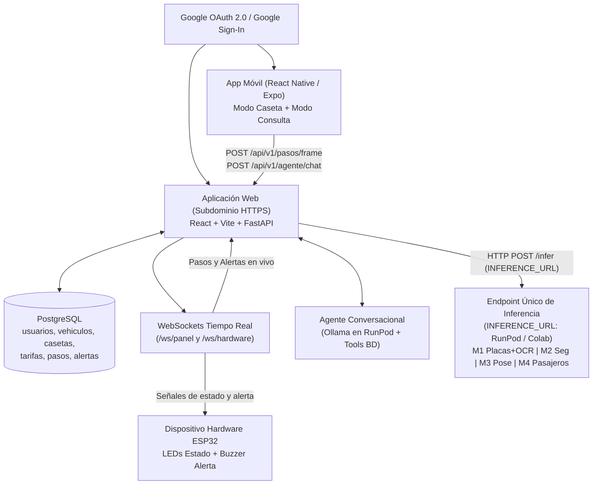

# Sistema Inteligente de Control de Peaje — IAM-811 (UNIFRANZ)

Sistema integral de control de peaje basado en visión por computadora, desplegado 100% en la nube, que integra cuatro modelos de Deep Learning (detección de placas + OCR, segmentación de vehículos, keypoints de ruedas para conteo de ejes y segmentación de pasajeros), inferencia en RunPod/Colab, aplicación web con panel en tiempo real vía WebSockets, autenticación exclusiva con Google OAuth 2.0 y lista blanca, agente conversacional (Ollama en RunPod + herramientas sobre BD), aplicación móvil (React Native / Expo) y dispositivo de alertas en hardware (ESP32).

---

## Integrantes y Roles

> Completar con los nombres reales del equipo antes de la entrega final.

| Integrante | Rol Principal | Responsabilidades |
|---|---|---|
| Integrante 1 | Datasets y Entrenamiento (M2, M3, M4) | Etiquetado en Roboflow, entrenamiento en Google Colab y métricas |
| Integrante 2 | Inferencia en la Nube y Entornos | Endpoint unificado en RunPod (Pod/Serverless), M1+OCR, conda/venv |
| Integrante 3 | Backend Web, Tiempo Real y Agente | FastAPI, PostgreSQL, Google OAuth 2.0, WebSockets, Ollama Agent |
| Integrante 4 | Frontend Web y Despliegue | Panel React en tiempo real, subdominio HTTPS, documentación |
| Integrante 5 | App Móvil y Hardware ESP32 | React Native (Expo) Modos Caseta/Consulta, APK, firmware ESP32 |

---

## Enlaces de Producción y Recursos

> Actualizar con las URLs reales una vez desplegado en la nube.

- **Aplicación Web (Subdominio HTTPS):** `https://peaje.tudominio.com`
- **Documentación Swagger / OpenAPI:** `https://peaje.tudominio.com/docs`
- **Endpoint de Inferencia (RunPod):** `https://TU-POD-ID-8000.proxy.runpod.net`
- **Dataset M2 (Segmentación de Vehículos — Roboflow):** `https://app.roboflow.com/tu-workspace/vehiculos-seg`
- **Dataset M3 (Keypoints de Ruedas — Roboflow):** `https://app.roboflow.com/tu-workspace/ruedas-pose`
- **Dataset M4 (Segmentación de Pasajeros — Roboflow):** `https://app.roboflow.com/tu-workspace/pasajeros-seg`
- **Carpeta en la Nube (Video, Informe PDF, APK, Capturas):** `https://drive.google.com/...`

---

## Arquitectura del Sistema



La aplicación web **no depende de dónde corre la inferencia**: cambiar entre RunPod y Google Colab requiere únicamente modificar la variable de entorno `INFERENCE_URL`.

---

## Tecnologías Utilizadas

- **Visión por Computadora / ML:** Ultralytics YOLO (Detección, Seg, Pose), EasyOCR / PaddleOCR, OpenCV, PyTorch + CUDA.
- **Gestión de Datasets y Entrenamiento:** Roboflow + Google Colab.
- **Inferencia en la Nube:** FastAPI + Uvicorn + Docker en RunPod (Pod o Serverless), con respaldo en Colab.
- **Backend Web y API:** Python 3.11, FastAPI, SQLAlchemy, PostgreSQL, WebSockets nativos, `google-auth` (OAuth 2.0), PyJWT.
- **Frontend Web:** React 18, Vite, TailwindCSS, `@react-oauth/google`, Lucide Icons.
- **Agente Conversacional:** Ollama en RunPod (`llama3.1:8b` con function calling sobre herramientas de BD) + motor determinista sin alucinaciones y corrección de confusiones OCR (`O↔0, I↔1, B↔8, S↔5`).
- **Aplicación Móvil:** React Native + Expo (`expo-camera`, `expo-auth-session`, `expo-secure-store`, `expo-image-picker`), compilación APK en la nube con EAS Build.
- **Hardware de Alertas:** ESP32 con WebSocketsClient (WSS), LEDs indicadores de proceso/alerta y buzzer.

---

## Estructura del Repositorio

```text
proyecto_caseta_IA/
├── entrenamiento/          # Notebooks de Colab (M1+OCR, M2, M3, M4, servidor Colab) + environment.yml
├── inferencia/             # Servidor único FastAPI (M1+M2+M3+M4) + Dockerfile RunPod + Serverless handler
├── web/
│   ├── backend/            # API REST v1, Google Auth, Lista Blanca, BD, WebSockets, Agente Ollama
│   └── frontend/           # SPA React con las 6 vistas mínimas + panel tiempo real
├── movil/                  # App React Native (Expo) - Modos Caseta y Consulta + eas.json
├── hardware/               # Firmware ESP32 para señales de inferencia y alertas
├── docs/                   # Colección Postman, diagramas, plantilla informe PDF, guion video, guía cloud
├── docker-compose.yml      # Despliegue VPS completo (PostgreSQL + Backend + Frontend)
├── .env.example            # Plantilla de variables de entorno (sin secretos)
└── README.md
```

---

## Gestión de Entornos (Conda / Mamba / Venv) — Bonificación +5

Cada servicio cuenta con archivos con **versiones fijadas** (`requirements.txt` y `environment.yml`) y un script de diagnóstico (`diagnostico_entorno.py`).

### 1. Servicio de Inferencia (`/inferencia`)
Con **Conda / Mamba (Miniforge)**:
```bash
mamba env create -f inferencia/environment.yml
mamba activate peaje-inferencia
python inferencia/diagnostico_entorno.py
```
Con **Python venv**:
```bash
python3.11 -m venv .venv-inferencia
source .venv-inferencia/bin/activate
pip install --no-cache-dir -r inferencia/requirements.txt
python inferencia/diagnostico_entorno.py
```

### 2. Backend Web (`/web/backend`)
Con **Conda / Mamba**:
```bash
mamba env create -f web/backend/environment.yml
mamba activate peaje-web
python web/backend/diagnostico_entorno.py
```
Con **Python venv**:
```bash
python3.11 -m venv .venv-web
source .venv-web/bin/activate
pip install --no-cache-dir -r web/backend/requirements.txt
python web/backend/diagnostico_entorno.py
```

### 3. Entrenamiento (`/entrenamiento`)
```bash
mamba env create -f entrenamiento/environment.yml
mamba activate peaje-entrenamiento
python entrenamiento/diagnostico_entorno.py
```

---

## Instrucciones de Despliegue en la Nube (Sin Recursos Locales)

Ver la guía detallada paso a paso en [docs/guia_despliegue_nube.md](docs/guia_despliegue_nube.md).

Resumen rápido:
1. **Google Cloud Console:** Crear credenciales OAuth 2.0 (Web + Android) y autorizar `https://peaje.tudominio.com`.
2. **Roboflow + Colab:** Etiquetar datasets de M2, M3 y M4 en Roboflow; ejecutar notebooks en `/entrenamiento` en Google Colab y guardar pesos `.pt`.
3. **RunPod (Inferencia + Ollama):** Desplegar el contenedor de `/inferencia` en un Pod GPU de RunPod (puerto `8000` expuesto) y opcionalmente Ollama (puerto `11434`). Copiar la URL pública a `INFERENCE_URL` y `OLLAMA_URL`.
4. **VPS / Cloud (Aplicación Web + Subdominio HTTPS):** Clonar el repo, crear `.env` desde `.env.example`, ejecutar `docker compose up -d --build` y publicar tras Caddy o Nginx con certificado Let's Encrypt HTTPS.
5. **App Móvil (APK en la nube):** Configurar `movil/.env` con la URL HTTPS del subdominio y compilar con `eas build -p android --profile preview`.
6. **Hardware ESP32:** Cargar `hardware/esp32_alerta_peaje/esp32_alerta_peaje.ino` configurando Wi-Fi, host del subdominio HTTPS y `HARDWARE_API_KEY`.

---

## Seguridad y Verificación

- Cuenta de docente pre-autorizada automáticamente como administrador: `doc.alvaro.pinto.ma@unifranz.edu.bo`.
- Acceso **exclusivamente** con Google OAuth 2.0 + lista blanca en base de datos.
- Ningún secreto, token o `client_secret` debe subirse al repositorio (`.gitignore` bloquea `.env` y credenciales).
- La identificación de pasajeros realiza únicamente detección/segmentación y conteo; **no realiza reconocimiento facial ni almacena recortes de rostros**.
