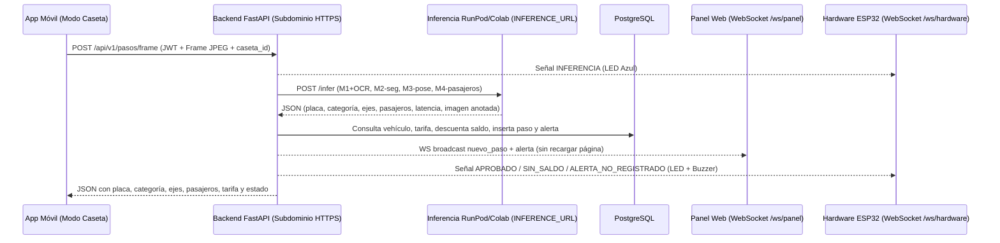
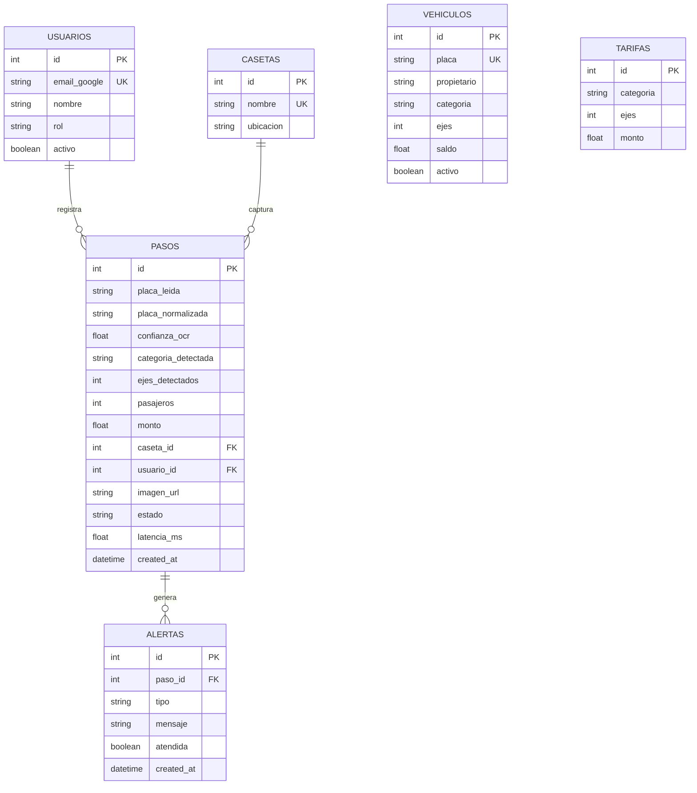
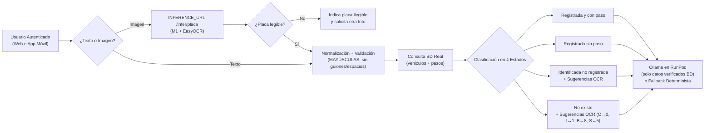

# Diagramas de Arquitectura — Sistema Inteligente de Control de Peaje

## 1. Flujo de Secuencia: Captura en Modo Caseta -> Tiempo Real -> Hardware

## 2. Diagrama Entidad-Relación (Base de Datos)

## 3. Flujo del Agente Conversacional (Texto o Imagen)

